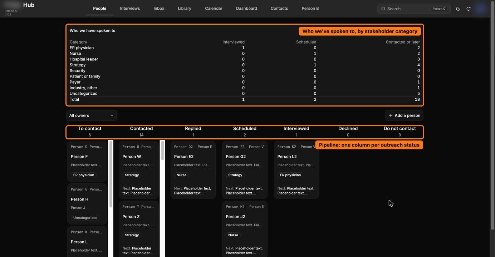
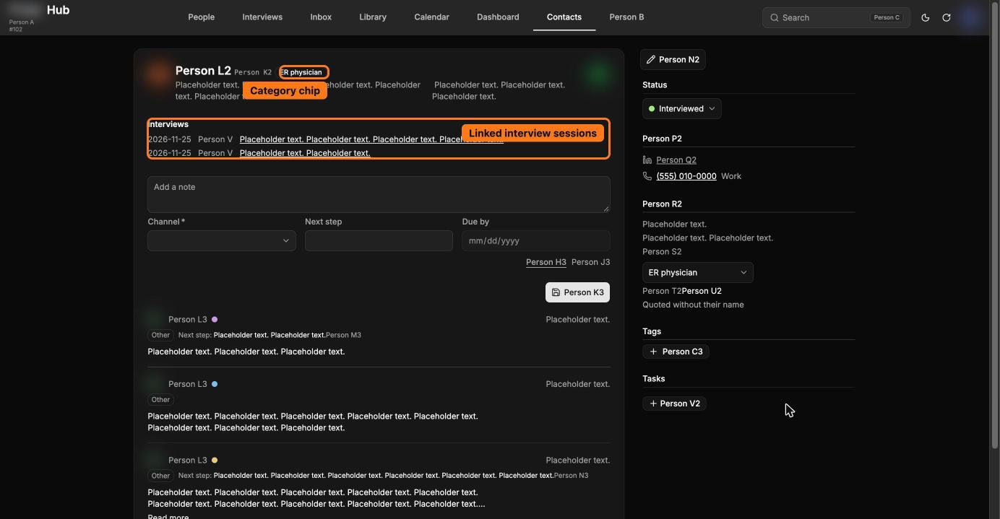
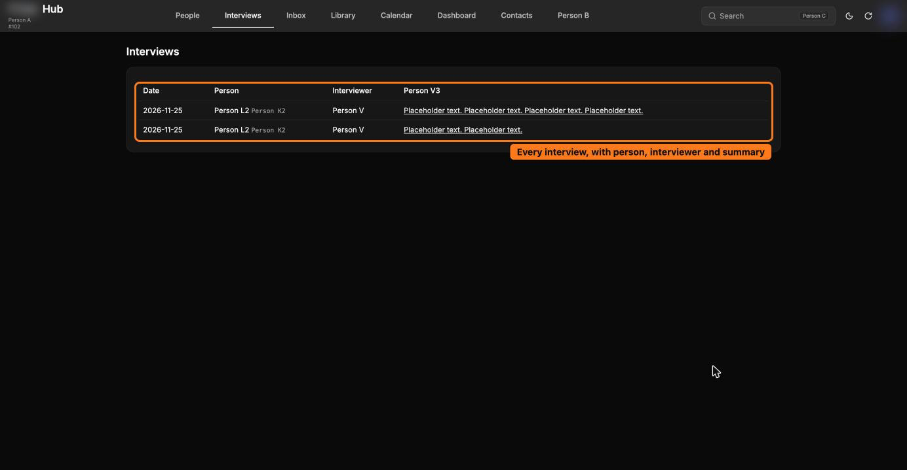
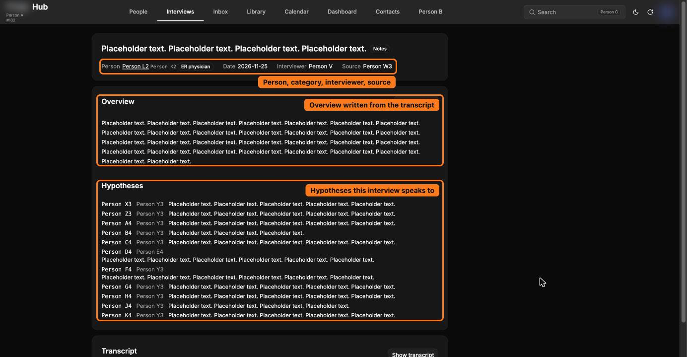
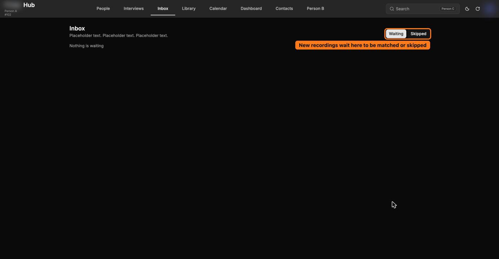
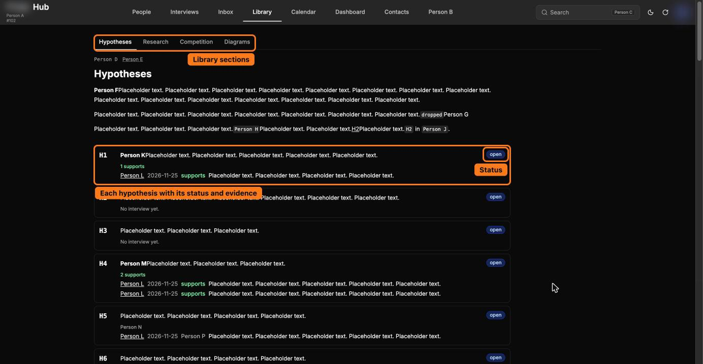
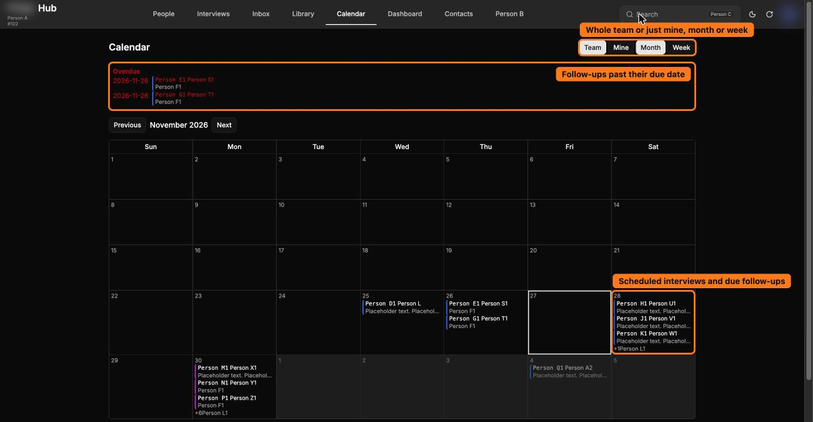

# CRM Kit

A research CRM for a student team doing customer discovery. It gives you:

- **A team hub:** a web app (a fork of Atomic CRM) on your own Supabase database, where everyone tracks people, outreach and interviews.
- **A command line,** `scripts/hub.py`, that writes to the hub with your own sign-in.
- **Claude skills** that log interviews and outreach for you while you talk.
- **A playbook:** how to interview, how to track hypotheses, and how to build the hub without drowning in process.

## Start here

1. Click **Use this template** on GitHub to make your team's own copy. Keep it private: it will hold real people's details.
2. Clone your copy and open it in Claude Code.
3. Type `/crm-setup`. The [setup skill](.claude/skills/crm-setup/SKILL.md) walks each teammate from a fresh clone to ready for their first interview, one checked step at a time.
4. The first teammate also creates the database: [docs/SETUP_SUPABASE.md](docs/SETUP_SUPABASE.md).

## Tour

Screens from a real team's hub. Every name, note, quote and hypothesis is replaced with placeholder text, and photos are blurred.

**People board.** Who you have spoken to, counted by stakeholder category, and every contact as a card in its outreach column.

**Person page.** One contact: category, linked interviews, outreach log and next step.

**Interviews.** Every interview with its person, interviewer and summary.

**Interview page.** The overview, the hypotheses it speaks to, and the full transcript below.

**Inbox.** New recordings wait here until someone matches them to a person or skips them.

**Library: hypotheses.** Each hypothesis with its status and the interviews that support or contradict it.

**Calendar.** Scheduled interviews and due follow-ups, with overdue ones on top.

## What to read

| Doc | What it is for |
|---|---|
| [FOCUS.md](FOCUS.md) | Your team's goal and the few things that matter. Fill it in first. |
| [docs/INTERVIEWING.md](docs/INTERVIEWING.md) | How to run an interview: listen, do not ask; keep transcripts verbatim; no blame. |
| [hypotheses/_TEMPLATE.md](hypotheses/_TEMPLATE.md) | The hypotheses table, with the nine business model canvas buckets explained. |
| [docs/PROTOCOL.md](docs/PROTOCOL.md) | How the hub itself gets changed: three lanes, sized by risk. |
| [docs/LESSONS.md](docs/LESSONS.md) | What we learned building the first version, so you can skip our mistakes. |
| [docs/SETUP_SUPABASE.md](docs/SETUP_SUPABASE.md) | Create your own Supabase project with Google sign-in. |
| [docs/DEVLOG.md](docs/DEVLOG.md) | One line per real change to the system. |

## Skills

Type these in Claude Code inside the repo:

- `/crm-setup`: get a teammate ready, from clone to first interview.
- `/crm-sync`: bring an interview into the hub, from a recording tool or pasted notes, with the whole transcript.
- `/crm-outreach`: log who you contacted and what needs a follow-up.
- `/crm-focus`: set or check the team's goal in `FOCUS.md`.
- `/crm-ticket` and `/crm-router`: turn a change to the hub into an issue and hand it to a worker.

Every skill pulls the latest from GitHub when it starts, so a fix one teammate pushes reaches everyone.

## Rules that matter most

- Transcripts go in word for word. Interpretation goes in the overview.
- Describe what people said they saw and did. Do not blame anyone.
- Nothing about a real person leaves the team without their consent.
- Measure progress by your `FOCUS.md` goal, not by how much you built.
